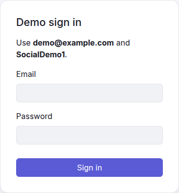
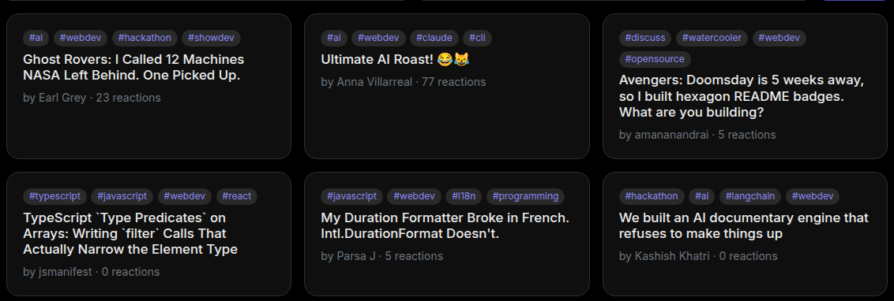

# SocialSphere

**Topic:** Social Media
**SocialSphere** - A responsive social media platform layout designed for sharing moments, exploring global trends, and connecting with peers.

## Group Information

* **Group:** SE-2539
* **Team Members:**
* Aidar Murat
* Ilya Koval
* Aldiyar Kairolin

## Description

SocialSphere is a multi-page web platform created for a frontend social network interface.Interface adapts smoothly across mobile, tablet, and desktop viewports.

## Features Implemented

* **Responsive Header & Navigation:** Sticky header with a logo and Flexbox-powered navigation bar integrated with Bootstrap's responsive collapse menu.

* **Feed & Posts System:** Layout displaying user posts, interaction bars (likes, comments, share), image lazy-loading, text-only gradient cards, and nested comment sections.

* **Trends & Rankings Table:** Dedicated trends page featuring topic cards, category grids, and a styled HTML data table highlighting post volume and engagement rates.

* **User Profile View:** Profile header with cover/avatar media, friend statistics, navigation tabs, quick bio details, and photo gallery grids.

* **Profile Settings:** Signed-in users can edit their display name.

* **Search & Category Filter:** Trends page live case-insensitive search combined with category filter buttons.

* **Trends CRUD Table:** Rankings table with add, edit (modal) and delete (confirmation) operations.

* **Image Gallery with Lightbox:** Profile page gallery grid with a lightbox, navigation arrows and jQuery fade transitions.

* **Light/Dark Theme Toggle:** Theme switch in the navigation bar, saved in localStorage and applied on every page.

* **Sign-in with localStorage:** Demo sign-in with form validation. Only the demo session and display name are stored in the browser. Signed-in users see their name on the profile page and in the settings form, get a welcome banner and can write comments; guests cannot comment.

* **FAQ Section:** Home page FAQ with jQuery `.slideToggle()` animation and +/− indicators.

* **API Integration:** Trends page loads articles from the public DEV Community API (`fetch`), with tag selection, filtering, refresh and error handling.

* **Footer Section:** Semantic footer featuring contact information, direct external links, and social icon badges.

## Technologies Used

* **HTML5:** Semantic structural elements (`<header>`, `<main>`, `<nav>`, `<article>`, `<footer>`, forms, and tables).

* **CSS3:** Flexbox, CSS Grid layout, CSS Variables (`:root`), `:hover`/`:focus` pseudo-classes, `:nth-child` styling, and media queries for responsiveness.

* **Bootstrap 5:** Grid system, utility classes, navigation toggle, tab panels, and modal components.

* **JavaScript & jQuery:** DOM manipulation, event handling, form validation, filtering, CRUD and fade effects.

* **Google Fonts:** Integrated Inter font family.

## Development Process

We built the page layouts and responsive navigation with HTML, CSS, and Bootstrap. We then added interactive features with JavaScript and jQuery, including the theme switch, demo sign-in, FAQ, and trends filters. The Trends page uses the public DEV Community API. We checked the sign-in flow, theme persistence, FAQ, and API behavior in Chrome, including article loading on GitHub Pages.

## Individual Contributions

* **Aidar Murat:**
* Developed `settings.html` and `settings.css`.
* Written and formatted `README.md` documentation.
* Developed trends search and category filter (`js/script.js`).

* **Ilya Koval:**
* Developed `profile.html` and `profile.css`
* Developed `posts.html` and `posts.css`
* Developed profile image gallery with lightbox (`js/script.js`)

* **Aldiyar Kairolin:**
* Developed global `style.css`
* Developed `index.html`
* Developed `trends.html`
* Developed the original registration form validation (`js/script.js`)

## Screenshots

**Demo sign-in on mobile**

**DEV Community articles on the Trends page**

## AI Usage

OpenAI Codex helped review the code against the project requirements, update demo sign-in and the local jQuery setup, verify functionality in Chrome, and prepare this report.

## Published Website

* **Live Demo:** [https://anommanager.github.io/social-network-frontend/](https://anommanager.github.io/social-network-frontend/)
* **GitHub Repository:** [https://github.com/anommanager/social-network-frontend.git](https://github.com/anommanager/social-network-frontend.git)
